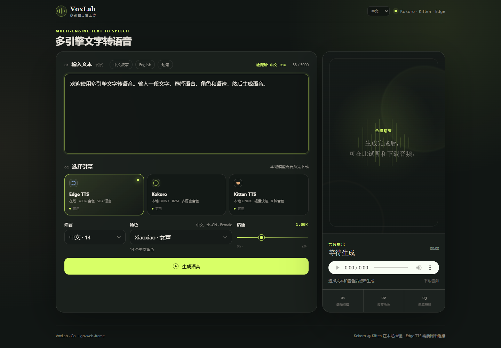
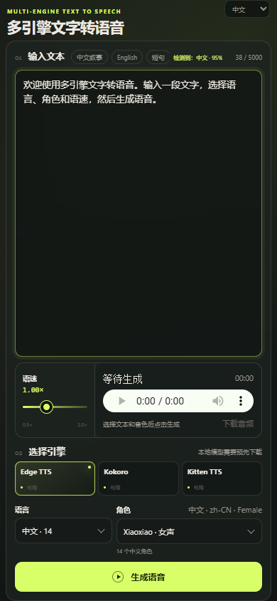

# go-tts / VoxLab

一个使用 Go + [`go-web-frame`](https://github.com/chuccp/go-web-frame) +
`html/template` 实现的多引擎文字转语音 Web 应用，支持：

- **Kokoro**：本地 ONNX、纯 Go 中文/英文 G2P、中文与英文音色、语速控制。
- **Kitten TTS**：本地轻量 ONNX、8 个内置音色、语速控制。
- **Edge TTS**：微软 Edge Read Aloud 在线音色，支持 400+ 音色和 90+ 语言。
- 界面支持中文和 English 切换，并记住上次选择。
- 自动检测输入语言，按“语言 → 角色”级联选择音色，并提示语言不匹配。
- 同一个页面内切换引擎、调节语速、试听和下载音频。
- 本地模型缺失或初始化失败时，仅禁用对应引擎，不影响 Edge TTS 使用。

## 界面预览

桌面界面：



手机界面：



## 系统要求

- Go 1.26 或更高版本，且启用 CGO。
- C 编译器：Windows 可使用 MinGW-w64，macOS 使用 Xcode Command Line Tools，Linux 使用 GCC。
- ONNX Runtime **1.25.0**：`onnxruntime_go` 的 C API 头文件对应该版本。
- 网络：仅 Edge TTS 需要联网。

Windows 可下载
[ONNX Runtime 1.25.0](https://github.com/microsoft/onnxruntime/releases/tag/v1.25.0)
中的 `onnxruntime-win-x64-1.25.0.zip`。解压后把 `lib/onnxruntime.dll` 放到项目根目录、
`runtime/` 或 `lib/` 下，也可以使用 `-onnx-lib` 指定绝对路径。

## 下载本地模型

预构建的 Kokoro FP32、Kokoro INT8、音色文件以及 Kitten TTS 模型统一发布在
[coke123/go-tts-models](https://huggingface.co/coke123/go-tts-models/tree/main)。

使用 Hugging Face CLI 一次下载默认 INT8 模型和 Kitten 所需文件：

```powershell
hf download coke123/go-tts-models `
  kokoro/kokoro-v0_19-int8.onnx `
  kokoro/voices-v1.0.bin `
  kitten/kitten_tts_nano_v0_8.onnx `
  kitten/voices.npz `
  kitten/config.json `
  --local-dir models
```

需要体积与精度之间的中间档时，可额外下载 UINT8 模型：

```powershell
hf download coke123/go-tts-models `
  kokoro/kokoro-v0_19-uint8.onnx `
  --local-dir models
```

### Kokoro

```text
models/
  kokoro/
    kokoro-v0_19.onnx
    kokoro-v0_19-int8.onnx
    kokoro-v0_19-uint8.onnx
    voices-v1.0.bin
```

- FP32 原模型：[kokoro-v0_19.onnx](https://huggingface.co/coke123/go-tts-models/resolve/main/kokoro/kokoro-v0_19.onnx)
- INT8 模型：[kokoro-v0_19-int8.onnx](https://huggingface.co/coke123/go-tts-models/resolve/main/kokoro/kokoro-v0_19-int8.onnx)
- UINT8 中间档：[kokoro-v0_19-uint8.onnx](https://huggingface.co/coke123/go-tts-models/resolve/main/kokoro/kokoro-v0_19-uint8.onnx)
- 音色：[voices-v1.0.bin](https://huggingface.co/coke123/go-tts-models/resolve/main/kokoro/voices-v1.0.bin)

虽然音色文件扩展名是 `.bin`，实际是包含多个 `.npy` 的 NPZ。应用也支持包含多个
`.npz`、`.npy` 或 raw float32 `.bin` 文件的音色目录。

默认配置使用约 88 MB 的预量化 INT8 模型，无需再下载权重转换工具或自行量化。
实测 INT8 模型启动工作集约 302 MB，原 FP32 模型约 517 MB。INT8 与 FP32 均保持相同的
`tokens/style/speed -> audio` 输入输出签名，可通过 `application.yml` 切换。
约 177 MB 的 UINT8 版本也已通过模型加载和非静音语音合成测试，适合需要中间体积的部署。

### Kitten TTS

```text
models/
  kitten/
    kitten_tts_nano_v0_8.onnx
    voices.npz
    config.json
```

从 [coke123/go-tts-models/kitten](https://huggingface.co/coke123/go-tts-models/tree/main/kitten)
下载 `kitten_tts_nano_v0_8.onnx`、`voices.npz` 和 `config.json`。也可换用同系列其他
轻量 ONNX 模型，并在 `application.yml` 中指定文件路径。

## 启动

```powershell
go mod tidy
go run .
```

应用默认读取根目录的 [`application.yml`](application.yml)，默认地址为
<http://localhost:8080>。程序不维护额外的命令行兼容层，启动参数和引擎路径统一由
`go-web-frame` 配置系统读取。

常用 YML 配置：

```yaml
web:
  server:
    port: 8080
    read_header_timeout: 5
    read_timeout: 30
  log:
    level: info

tts:
  max_chars: 5000
  onnx:
    runtime_lib: ""
  edge:
    default_voice: zh-CN-XiaoxiaoNeural
    proxy: ""
  kokoro:
    model: models/kokoro/kokoro-v0_19-int8.onnx
    voices: models/kokoro/voices-v1.0.bin
  kitten:
    model: models/kitten/kitten_tts_nano_v0_8.onnx
    voices: models/kitten/voices.npz
    config: models/kitten/config.json

captcha:
  enabled: true
  limit: 10
  period: 600
```

Kokoro 与 Kitten 不再启动任何外部音素化程序。中文使用内嵌 pypinyin 词组词典和
Misaki 拼音到 IPA 映射；英文使用内嵌 Misaki 词典及 ONNX 发音回退模型。

## 点击验证与限流

合成接口默认启用点击验证。同一个客户端在滚动时间窗口内前 10 次可以正常合成，
后续请求会要求依次点击图片中的 3 个图形图标。图标不包含文字，避免不同语言和文化
造成的歧义。完成验证后计数会重置。

- IP 和 HttpOnly Cookie 两套计数同时生效；任意一个达到上限都会触发验证。
- `captcha.enabled`：设为 `false` 可完全关闭验证。
- `captcha.limit`：时间窗口内允许的合成次数。
- `captcha.period`：滚动时间窗口，单位为秒；例如 `600` 表示 10 分钟。

验证图使用内嵌 SVG 图标，点击坐标只保存在 AES-GCM 加密的挑战数据中，不会以明文
发送给浏览器。
验证成功后返回的票据与客户端 Cookie 绑定，且只能使用一次。

## HTTP 接口

`POST /api/synthesize`，使用 `application/x-www-form-urlencoded`：

```text
engine=edge
voice=zh-CN-XiaoxiaoNeural
text=你好，世界
speed=1.0
```

成功时直接返回 `audio/mpeg` 或 `audio/wav`，失败时返回 JSON：

```json
{"error":"具体错误信息"}
```

当触发点击验证时返回 `428 Precondition Required`：

```json
{
  "captchaRequired": true,
  "captcha": {
    "type": "click",
    "image": "data:image/svg+xml;base64,...",
    "targets": [
      "data:image/svg+xml;base64,...",
      "data:image/svg+xml;base64,...",
      "data:image/svg+xml;base64,..."
    ],
    "clickCode": "...",
    "expiresIn": 120
  }
}
```

验证成功后，再次提交 `/api/synthesize` 时附加 `captchaTicket` 表单字段。

其他接口：

- `GET /api/voices?engine=edge|kokoro|kitten`
- `GET /api/captcha/challenge`
- `POST /api/captcha/verify`
- `GET /healthz`

## 测试

默认测试不访问网络，也不需要加载几百 MB 的模型：

```powershell
go test ./...
go test -race ./...
go vet ./...
```

使用本机已下载的 Kokoro、Kitten 和 ONNX Runtime 运行真实推理测试：

```powershell
$env:TTS_INTEGRATION = "1"
go test ./internal/tts -run TestLocalEngineIntegration -v
```

可通过 `TTS_KOKORO_MODEL` 指定要验证的 Kokoro 模型：

```powershell
$env:TTS_INTEGRATION = "1"
$env:TTS_KOKORO_MODEL = "models/kokoro/kokoro-v0_19-uint8.onnx"
go test ./internal/tts -run TestLocalEngineIntegration -v
```

调用真实 Edge TTS 服务：

```powershell
$env:TTS_NETWORK_INTEGRATION = "1"
go test ./internal/tts -run TestEdgeLiveIntegration -v
```

两类集成测试在未设置对应环境变量时会自动跳过，适合普通 CI 和离线开发。

## 实现说明

- Web 路由、Controller、Filter、静态资源和安全响应头由 `go-web-frame` 管理。
- TTS 引擎由框架 Service 初始化，Controller 通过框架依赖注入获取。
- 使用 `WebFrame.Run()` 管理 Web 服务生命周期和优雅退出。
- Edge TTS 直接使用 WebSocket 协议，包含当前 `Sec-MS-GEC` v2 令牌生成，不依赖 Python。
- 长文本按句拆分；Kokoro 还会在音素 token 超过模型限制时继续递归拆分。
- 中文 G2P 使用最长词组匹配处理“银行行长”“重庆”“重复”等多音字场景。
- 英文 G2P 使用 `go-g2p` 的内嵌词典、词性模型和神经网络未知词回退，不启动外部进程。
- Kokoro 输出 24 kHz float32 PCM，服务端转为单声道 16-bit WAV。
- Edge 输出 `audio-24khz-48kbitrate-mono-mp3`；长文本的 MP3 分片在服务端顺序拼接。
- 本地音色 NPZ/NPY 使用 Go 标准库解析，不依赖 NumPy。

Edge Read Aloud 是非正式接口，服务端行为可能变化，并受微软相关条款约束。Kokoro、
Kitten 的模型文件许可与代码许可相互独立，请在使用或分发前分别确认。
